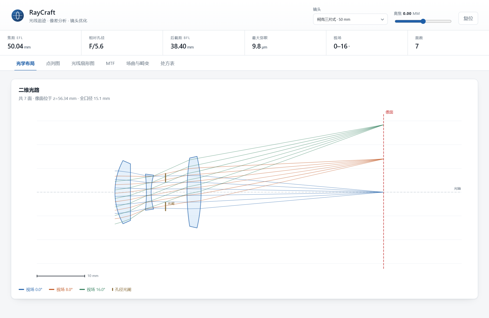
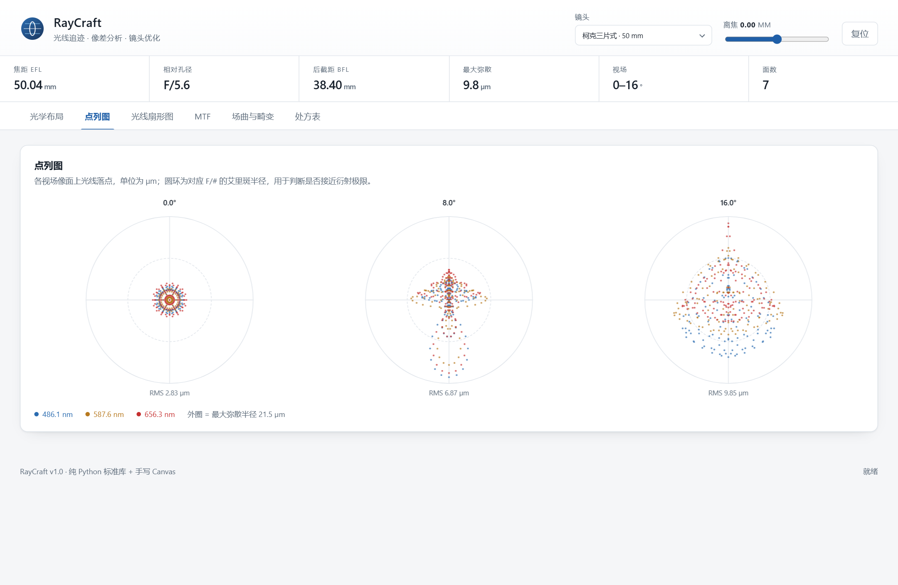
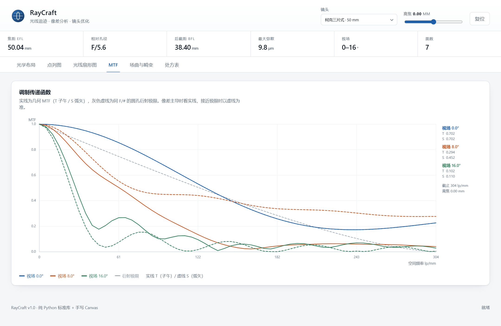
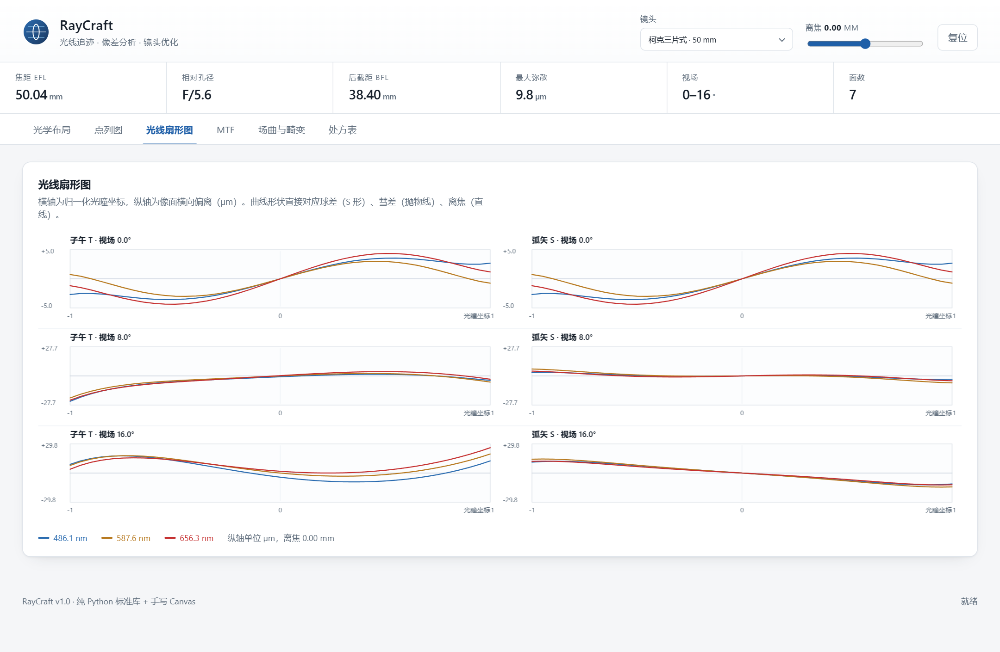
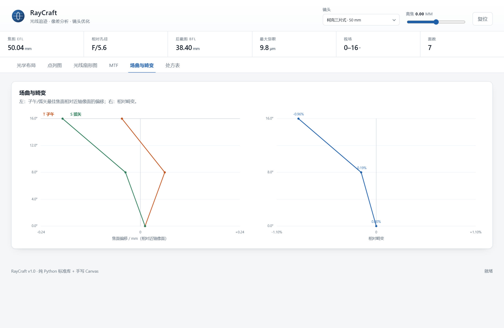

# RayCraft — 光线追迹与镜头设计工作台

**零依赖的序列式光学系统仿真与自动优化引擎，附带一个手写 Canvas 的浏览器工作台。**

RayCraft 从一纸处方（曲率半径 / 厚度 / 玻璃牌号）出发，做真实的**三维矢量光线追迹**，
给出点列图、光线扇形图、场曲、畸变、MTF 等一整套像质评价，并能用**阻尼最小二乘法（DLS）**
反过头来修正这些半径与间隔——把「一片随便填数的三片式」优化成「轴上 4 µm、全视场 14 µm」的镜头。

整个项目只使用 Python 标准库：没有 NumPy、没有 SciPy、没有 matplotlib，
连 Web UI 的绘图都是手写的 Canvas 2D。`pip install` 一行都不需要。

```
                    ┌──────────────┐
   prescription ───▶│  surface.py  │  球面 / 二次曲面 / 偶次非球面求交
   (R, t, glass)    │  system.py   │  近轴矩阵 + 矢量斯涅尔追迹
                    └──────┬───────┘
                           │  像面上的落点
                    ┌──────▼───────┐        ┌──────────────┐
                    │ analysis.py  │───────▶│  像质评价    │
                    │              │        │  spot / fan  │
                    └──────┬───────┘        │  MTF / field │
                           │                └──────────────┘
                    ┌──────▼───────┐
                    │ optimize.py  │  DLS：把 RMS 光斑压下去
                    └──────────────┘
```

---

## 目录

- [效果预览](#效果预览)
- [功能说明](#功能说明)
- [镜头库](#镜头库)
- [环境与依赖](#环境与依赖)
- [安装与运行](#安装与运行)
- [使用示例](#使用示例)
- [技术方案](#技术方案)
- [项目结构](#项目结构)
- [测试](#测试)
- [设计取舍与已知限制](#设计取舍与已知限制)
- [许可](#许可)

---

## 效果预览

二维光路图：三个视场（0° / 8° / 16°）的光线在像面上各自收敛成一个点，
玻璃体按真实矢高绘制，光阑、像面、标尺都标了出来。



点列图：每个视场叠加 F / d / C 三条谱线，外圈是 F/# 对应的艾里斑。
柯克三片式轴上 RMS 2.8 µm，全视场 9.9 µm，基本落在衍射限内。



MTF：实线是子午方向，虚线是弧矢方向，灰虚线是圆孔衍射极限。



光线扇形图：横轴是归一化光瞳坐标，纵轴是像面横向偏离（µm）。
S 形曲线对应球差、直线斜率对应离焦、不对称对应彗差——像差的"指纹"一眼可辨。



场曲与畸变：左图是子午/弧矢最佳焦面相对近轴像面的偏移，右图是相对畸变。



---

## 功能说明

### 几何与追迹

| 能力 | 说明 |
|---|---|
| 面型 | 平面、球面、二次曲面（conic `k`）、偶次非球面（`A4, A6, A8…`） |
| 折射 | 三维矢量斯涅尔定律，法线自动取向，支持全反射检测与反射面 |
| 求交 | 二次曲面走**闭式解**（快且不失根），非球面走**阻尼牛顿**（稳定） |
| 口径 | 逐面通光口径拦光，统计渐晕光线数 |
| 物距 | 无穷远（平行光）或有限共轭（有限物距 + 物高） |
| 波长 | 任意波长列表，玻璃折射率由 Sellmeier 方程给出 |

### 近轴光学

- 系统矩阵 `M = [[1,0],[-Φ/n', n/n']] · [[1,t],[0,1]]` 逐面累乘
- 有效焦距 `EFL = -1/M[1][0]`，后截距 `BFL = -M[0][0]/M[1][0]`
- 入瞳位置与半径由光阑到物方的子矩阵给出：`R_ep = R_stop / M_s[0][0]`
- 相对孔径 `F/# = |EFL| / (2·R_ep)`、像方数值孔径 `NA = 1/(2·F/#)`
- 相似变换缩放：`scale(2.0)` 让焦距翻倍而像差比例完全不变

### 像质评价

| 指标 | 实现要点 |
|---|---|
| 点列图 | 六角极坐标光瞳采样，分波长着色，按主光线定位、按质心算 RMS |
| 光线扇形图 | 子午 / 弧矢各 41 条光线，纵轴为相对主光线的横向偏离 |
| 场曲 | 每个视场在 ±4 mm 内粗扫 + 抛物线拟合，分别找 T / S 最佳焦面 |
| 畸变 | 真实主光线像高 vs 近轴像高，`(y_real − y_par)/y_par` |
| 几何 MTF | 光瞳采样落点的特征函数法 `\|(1/N)Σ exp(−2πi·f·x_i)\|`，含衍射极限参考 |
| 能量集中度 | 按半径排序后取包围比例曲线 |

### 自动优化

- **阻尼最小二乘**（Levenberg–Marquardt）：`(JᵀJ + λ·diag) δ = −Jᵀ r`
  - `merit` 下降 → 接受并 `λ ← λ/3`；否则回滚并 `λ ← λ×10`
  - 雅可比用前向差分构造，含自适应步长
- **残差设计**：每个视场以**主波长像斑质心**为唯一参考点，再计入其余波长的落点。
  这样色差与单色像差会被同时压低；若各波长各自取质心，色差会被悄悄"优化掉"。
- **硬约束**：焦距、F/#、最小像距、中心厚度、边缘厚度、空气间隔——全部转成带权残差项
- **整组调焦**：像面可以整体前后移动，这是控制场曲的关键自由度
- **对称约束**：`Variable.mirror` 让镜像面联动更新，保住对称结构的低畸变特性
- **多起点**：随机扰动半径后分别优化，取 merit 最小者，跳出局部极小

---

## 镜头库

四个结构递进的预设，覆盖「完全没校正」到「逼近衍射限」：

| 名称 | EFL | F/# | 视场 | RMS 光斑（轴上/中间/边缘，µm） | MTF@40 lp/mm |
|---|---|---|---|---|---|
| `singlet` 平凸单透镜 | 100.0 mm | 4.0 | 0–6° | 172.0 / 205.3 / 312.9 | 0.07 |
| `achromat` 双胶合消色差 | 99.7 mm | 6.0 | 0–3° | 9.1 / 4.9 / 16.9 | 0.67 |
| `cooke_triplet` 柯克三片式 | 50.0 mm | 5.6 | 0–16° | 2.8 / 7.1 / 9.9 | 0.94 |
| `asphere` 双面非球面 | 32.2 mm | 2.8 | 0–2° | 2.7 / 1.3 / 4.4 | 0.89 |

- **singlet**：对照组。像面取在近轴焦点上，轴向球差 LSA ≈ 1.73 mm（占焦距 1.7%），
  点列图直接展示"球差长什么样"。
- **achromat**：N-BK7 + F2 胶合，F 光与 C 光焦点重合，轴向色差被压到衍射量级。
- **cooke_triplet**：正–负–正三片把球差、彗差、像散、场曲同时压到几微米，三阶像差平衡的教科书案例。
- **asphere**：两个面都带 conic 与偶次项，633 nm 单色，F/2.8 下艾里半径 2.2 µm，
  轴上/轴外 RMS 都在 5 µm 以内——展示"一片非球面顶一组球面"的真实含义。

这些数字不是手写死的常量，而是 `tests/test_raycraft.py` 的回归基准（`library.REFERENCE`），
任何把像质改坏的改动都会被 CI 拦下。

---

## 环境与依赖

- **Python ≥ 3.8**（标准库 `unittest` / `http.server` / `dataclasses`）
- **零第三方依赖**——不需要 NumPy、SciPy、matplotlib、Flask
- 浏览器工作台需要任意现代浏览器（Chrome / Edge / Firefox / Safari）
- 可选：`playwright` 仅用于开发期截图，运行时不使用

```bash
python --version      # 确认 ≥ 3.8
```

## 安装与运行

无需安装，克隆后直接跑：

```bash
git clone https://github.com/<your-name>/raycraft.git
cd raycraft

# 1) 启动浏览器工作台（默认 http://127.0.0.1:8781）
python run.py serve

# 2) 或者只用命令行
python run.py systems
python run.py info --name cooke_triplet
```

> `run.py` 只是把项目根目录塞进 `sys.path` 后调用 CLI 主入口，
> 这样在嵌入式 Python 发行版里也能直接运行。
> 如果 `raycraft` 已装成包（或已经 `cd` 到项目根目录），也可以直接 `python -m raycraft.cli`。

其它启动方式：

```bash
python -m unittest discover -s tests -v   # 跑测试
python run_tests.py                       # 跑测试并打印汇总
python run_demos.py                       # 跑 9 个能力演示
python examples/custom_design.py          # 从零建一个镜头并优化它
```

---

## 使用示例

### 1. 命令行：看处方、看像质

```bash
$ python run.py info --name cooke_triplet
cooke_triplet — f=50 mm 柯克三片式，F/5.6，全视场 ±16°（32°）。正-负-正三片把球差、彗差、像散与场曲同时压到几微米，是三阶像差平衡的教科书结构。
──────────────────────────────────────────────────────────────────────────────
焦距 EFL=50.0449 mm   后焦距 BFL=38.3965 mm   F/#=5.600   NA≈0.0893
入瞳位置 z=+8.1025 mm   入瞳半径 4.4683 mm   光阑=第 5 面
视场 [0.0, 8.0, 16.0] °    波长 [486.13, 587.56, 656.27] nm

处方
──────────────────────────────────────────────────────────────────────────────
  #       半径/mm     厚度/mm        材料      半口径       k  位置 z
  1     13.9790     3.259    N-SK16    6.652   0.000     0.000
  2           ∞     3.337       air    5.964   0.000     3.259
  3    -35.9837     1.000        F2    3.808   0.000     6.596
  4     12.8607     3.018       air    3.576   0.000     7.596
  5           ∞     4.500       air    3.321   0.000    10.615 [光阑]
  6     46.2218     2.952    N-SK16    7.185   0.000    15.115
  7    -33.6696     0.000       air    7.534   0.000    18.067

像面位于 z = 56.3416 mm（近轴焦点 56.4638 mm + 调焦 -0.1222 mm）
```

```bash
$ python run.py spot --name cooke_triplet --rings 6
$ python run.py mtf  --name asphere
$ python run.py field --name singlet
$ python run.py optimize --name achromat --iterations 40 --starts 3
```

### 2. Python API：三行拿到点列图

```python
from raycraft import library, analysis

system = library.get("cooke_triplet")
print(f"EFL={system.efl:.2f} mm  F/{system.f_number:.1f}")

for field in system.fields:
    spot = analysis.spot_diagram(system, field, rings=5)
    print(f"  {field:5.1f}°  RMS = {spot['rms']*1000:6.2f} µm  "
          f"（{spot['rays']} 条光线，{spot['vignetted']} 条被拦）")
```

### 3. Python API：自己搭一个镜头

```python
import math
from raycraft import analysis, materials
from raycraft.surface import Surface
from raycraft.system import OpticalSystem

s = OpticalSystem(
    "my_doublet",
    [
        Surface(70.0, 6.0, "N-BK7", 10.0, is_stop=True, label="冕牌 前"),
        Surface(-45.0, 3.0, "F2",   10.0, label="胶合面"),
        Surface(-160.0, 0.0, "air", 10.0, label="火石 后"),
    ],
    fields=(0.0, 1.0, 2.0),
    wavelengths=(materials.F_LINE, materials.D_LINE, materials.C_LINE),
)
# 把光阑缩到 F/6
s.surfaces[s.stop_index].semi_diameter *= s.f_number / 6.0
s._solve()
s.autosize()

print(s.efl, s.f_number)
print(analysis.distortion(s))
```

### 4. Python API：优化一个镜头

```python
from raycraft import analysis, library
from raycraft.optimize import Optimizer, Variable, default_variables, multi_start

s = library.get("cooke_triplet")

# 默认变量 = 全部半径 + 空气间隔 + 整组调焦
res = multi_start(s, starts=4, iterations=60,
                  target_efl=50.0, target_f_number=5.6)
best = res["system"]
print(f"merit {res['history'][0]:.3e} → {res['merit']:.3e}")

for f in best.fields:
    print(f, analysis.spot_diagram(best, f, rings=5)["rms"] * 1000, "µm")
```

只想动某几个面时，手工列变量即可：

```python
variables = [
    Variable(0, "radius", 15.0, 300.0),                    # 第 1 面半径
    Variable(2, "radius", -300.0, -8.0, mirror=(4, -1.0)), # 与第 5 面镜像联动
    Variable(-1, "focus", -2.0, 2.0, step=0.0),            # 整组调焦
]
Optimizer(s, variables, rings=3, target_efl=50.0).run(iterations=40)
```

### 5. HTTP API

`python run.py serve` 之后：

| 接口 | 说明 |
|---|---|
| `GET /api/systems` | 镜头列表与摘要 |
| `GET /api/design?name=cooke_triplet&defocus=0` | 处方 + 光路 + 点列图 + 畸变 |
| `GET /api/spots?name=achromat` | 各视场点列图原始落点 |
| `GET /api/fans?name=singlet` | 子午/弧矢扇形图 |
| `GET /api/mtf?name=asphere&rays=2200` | 几何 MTF + 衍射极限 |
| `GET /api/field?name=singlet` | 场曲与畸变 |
| `GET /api/glasses` | 玻璃目录（nd / Vd / 系数） |

```bash
curl -s "http://127.0.0.1:8781/api/mtf?name=asphere" | python -m json.tool | head
```

服务端用 `ThreadingHTTPServer`，带 LRU 式内存缓存、`inf/nan → null` 清洗，
静态文件路径做穿越防护。

---

## 技术方案

### 1. 近轴矩阵

每个面贡献一个折射矩阵，每段间隔贡献一个平移矩阵：

```
折射  [[1, 0], [-Φ/n', n/n']]      Φ = (n' − n)·c
平移  [[1, t], [0, 1]]
```

累乘得到系统矩阵 `M`，于是

```
EFL = −1 / M[1][0]        BFL = −M[0][0] / M[1][0]
```

装调时不需要另写一套近轴代码——`EFL` / `BFL` / 入瞳全部从同一个矩阵里读出来，
这也保证了近轴解和实光线追迹用的是同一份处方。

### 2. 矢量斯涅尔定律

```
μ = n / n'
cos i = −(d · n̂)
sin²t = μ²(1 − cos²i)
若 sin²t > 1 → 全反射
d' = μ·d + (μ·cos i − cos t)·n̂
```

法线取向统一到"与入射方向相对"的一侧，所以球面、二次曲面、反射面共用同一段代码。

### 3. 面型求交

矢高：

```
z(r²) = c·r² / (1 + sqrt(1 − (1+k)c²r²)) + Σ A_i·r^(2i+4)
```

- **二次曲面**：把上式代进直线方程，得到关于传播距离 `t` 的二次方程，闭式解。
  判别式 < 0 表示光线擦不到这个面。
- **偶次非球面**：以切平面交点为初值，对隐式方程 `F(t) = z(t) − sag(r²(t))` 做
  **阻尼牛顿迭代**，步长限幅、最多 60 次，保证在强非球面上也不发散。

### 4. 几何 MTF

把光瞳均分为 N 个采样点，追迹到像面得到落点 `x_i`（相对主光线），
调制传递函数就是落点分布的**特征函数模**：

```
MTF(f) = | (1/N) · Σ exp(−2πi·f·x_i) |
```

子午方向用 `y_i`，弧矢方向用 `x_i`。这是纯几何近似（不含衍射），
所以低频可能略高于衍射极限——界面上同时画出圆孔衍射 MTF 作为参考。

### 5. 阻尼最小二乘

```
(JᵀJ + λ·diag(JᵀJ)) δ = −Jᵀ r
```

- `r` 是"各视场 × 各波长 × 各光瞳采样点"的横向偏离，按比例因子归一
- `J` 由前向差分构造，步长 `max(相对步长·|x|, 绝对下限)`
- `merit` 下降则接受并减小 `λ`（趋向高斯–牛顿，快），
  否则回滚并增大 `λ`（趋向梯度下降，稳）

镜头设计的 merit 面通常有多个局部极小（不同的弯曲方式都能满足一阶条件），
所以还提供了 `multi_start()`：随机扰动半径 → 各自优化 → 取最好。

---

## 项目结构

```
raycraft/
├── raycraft/                 核心库（零依赖）
│   ├── __init__.py           包导出与版本号
│   ├── materials.py          12 颗 Schott 玻璃的 Sellmeier 系数、阿贝数
│   ├── surface.py            面型几何：矢高、法线、求交（闭式解 + 牛顿）
│   ├── system.py             光学系统：近轴矩阵、矢量追迹、入瞳、自动定口径
│   ├── analysis.py           点列图、扇形图、场曲、畸变、MTF、能量集中度、布局
│   ├── optimize.py           DLS 优化器、变量、约束、多起点
│   ├── library.py            4 个镜头处方 + 回归基准
│   ├── cli.py                命令行子命令
│   └── server.py             http.server 路由与静态文件服务
├── web/                      浏览器工作台（手写 Canvas，无框架）
│   ├── index.html            6 个标签页的骨架
│   ├── style.css             浅色专业风格
│   └── app.js                全部绘图与交互
├── tests/
│   └── test_raycraft.py      77 个单元测试
├── examples/
│   ├── custom_design.py      从零建镜头 + 优化 + 导出 JSON
│   └── out/                  示例输出（运行后生成）
├── docs/                     README 用的截图
├── .github/workflows/        CI：多版本 Python 跑测试
├── run.py                    启动引导（CLI 入口）
├── run_tests.py              测试汇总
├── run_demos.py              9 个能力演示
├── pyproject.toml            打包元数据
└── README.md
```

### 模块依赖方向

```
materials ──┐
surface  ───┼──▶ system ──▶ analysis ──▶ optimize
            │        │
            └────────┴────▶ library ──▶ cli / server
```

`analysis` 只读 `system`，`optimize` 只读 `analysis` 的指标，
`library` 组合前四者。所以任何一层都可以单独替换。

---

## 测试

```bash
$ python run_tests.py
............................................................................. 
────────────────────────────────────────────────────────────
共 77 项：通过 77，失败 0，错误 0
────────────────────────────────────────────────────────────
```

测试覆盖：

- **物理正确性**：厚透镜 EFL 与解析式一致（1e-4）、系统矩阵行列式 = n'/n、
  球面矢高与 `R − sqrt(R²−y²)` 一致、二次曲面 `k=−1` 退化为抛物线、
  平面折射满足 `n₁sinθ₁ = n₂sinθ₂`、全反射临界角
- **数值稳定性**：非球面牛顿求交在 41 个光瞳位置上连续、所有预设的逐面口径都不拦光
- **像质回归**：`library.REFERENCE` 与实算 RMS 偏差 < 8%
- **优化器**：线性方程组、奇异矩阵、merit 单调下降、变量钳位、镜像联动、结构约束
- **接口**：7 个 HTTP 接口的返回结构、404 分支、路径穿越防护、CLI 各子命令

CI（GitHub Actions）在 Python 3.8 / 3.10 / 3.12 上各跑一遍。

---

## 设计取舍与已知限制

诚实地说明这个项目**不做**什么，以及为什么：

| 限制 | 原因 / 影响 |
|---|---|
| 只有旋转对称的序列式系统 | 不含偏心、倾斜、自由曲面；离轴反射系统需要额外的一般化坐标变换 |
| 几何 MTF，不含衍射 | 低频可能高于衍射极限，强像差时曲线会振荡；界面同时画衍射参考线 |
| 不建模鬼像 / 杂散光 | 需要膜层与散射模型 |
| 不考虑热光学与公差 | 需要材料热膨胀与装配误差分布 |
| 优化是局部方法 | 多起点只能缓解，不能保证全局最优 |
| 玻璃库 12 颗 | 够覆盖冕牌/火石/镧系的主要组合，不是全目录 |
| 光学设计≠照相 | 没有做 MTF 平衡、渐晕设计、色彩还原这些"镜头配方"之外的工程内容 |

这些限制不是"没做完"，而是**范围声明**：RayCraft 的目标是把从处方到像质评价再到
自动优化这条链路完整、干净、可验证地实现出来，而不是复刻 Zemax。

---

## 许可

MIT License，见 [LICENSE](LICENSE)。

玻璃的 Sellmeier 系数来自公开的 Schott 数据手册，仅用于教学与工程估算；
实际投产请以厂商最新数据为准。
